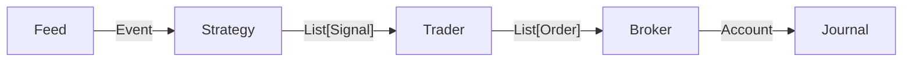
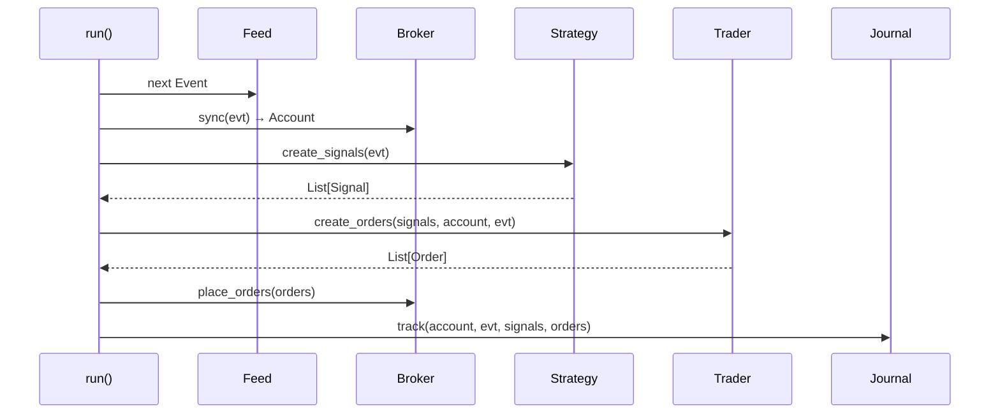

# roboquant_mojo

A [Mojo](https://www.modular.com/mojo) port of [roboquant](https://github.com/roboquant/roboquant):
an event-driven backtesting and algo-trading engine.

It is designed to be a **framework** rather than a **ready-to-trade system**: it provides the plumbing for an end-to-end backtest or walk-forward simulation, but you still need to implement your own strategy and broker adapters.


Right now it is in a proof-of-concept stage, with only a synthetic and simple CSV feed and simulated broker. 
The goal is to have a fully functional end-to-end flow that can be extended with real data and brokers.

The engine replays a stream of price events through a small number of
interchangeable components — a **feed**, a **strategy**, a **trader**, a
**broker** and a **journal**.



---

## Contents

- [roboquant\_mojo](#roboquant_mojo)
  - [Contents](#contents)
  - [Install \& run](#install--run)
  - [Quick start](#quick-start)
  - [Architecture](#architecture)
  - [Data flow](#data-flow)
  - [Component reference](#component-reference)
    - [Time \& money](#time--money)
    - [Instruments \& orders](#instruments--orders)
    - [Account](#account)
    - [Feed](#feed)
    - [Strategy](#strategy)
    - [Trader](#trader)
    - [Broker](#broker)
    - [Journal](#journal)
    - [Orchestration](#orchestration)
  - [Concepts](#concepts)
  - [Repository layout](#repository-layout)
  - [Testing](#testing)
  - [Implementation status](#implementation-status)

---

## Install & run

```bash
# Install (or refresh) the pixi environment
pixi install

# Run the bundled tests
pixi run test
```

The modules inside `roboquant/` use relative imports (`from .feed import ...`)
and are imported as a package (`from roboquant.feed import ...`). The `pixi`
tasks above precompile them into `lib/roboquant.mojoc` and add that directory to
the module path with `-I lib`.

The demo generates ~26 years of 10-minute random-walk bars, runs a full-history
backtest and then a 10-step walk-forward simulation:

```text
total bars:  <N>
<Timeframe> => time=<seconds> trades=<n> bars/s=<rate> equity=<Amount>
...
```

## Quick start

A minimal end-to-end backtest wires the stock implementations together:

```mojo
from roboquant.feed import random_walk
from roboquant.strategy import EMACrossOver
from roboquant.trader import FlexTrader
from roboquant.broker import SimBroker
from roboquant.journal import EquityTracker
from roboquant.run import run

def main() raises:
    # 1-hour bars over one year for 8 synthetic tickers
    var feed = random_walk(
        start="2025-01-01", end="2026-01-01", step_seconds=3600.0, n_assets=8
    )

    var strategy = EMACrossOver()   # strategy
    var trader = FlexTrader()       # trader
    var broker = SimBroker()        # broker (starts with 100k USD)
    var journal = EquityTracker()   # journal

    run(feed, strategy, trader, broker, journal)

    print("performance:", journal.get_performance() * 100.0, "%")
```

Every component is a `trait`, so you only need to implement the relevant
methods to plug in your own version — for example a strategy that returns
`Signal`s, or a broker that talks to a real exchange.

## Architecture

The design is built around traits, one per responsibility:

| Trait       | File                      | Responsibility                                        |
| ----------- | ------------------------- | ----------------------------------------------------- |
| `PriceItem` | `roboquant/feed.mojo`     | A single price/volume observation for one asset       |
| `Strategy`  | `roboquant/strategy.mojo` | Turn an `Event` into a list of `Signal`s              |
| `Trader`    | `roboquant/trader.mojo`   | Turn `Signal`s + `Account` into a list of `Order`s    |
| `Broker`    | `roboquant/broker.mojo`   | Execute orders and report the updated `Account`       |
| `Journal`   | `roboquant/journal.mojo`  | Observe (and optionally persist) what happened        |

`run()` (`roboquant/run.mojo`) is the only place that knows about all of them,
keeping the components independent and easy to swap.

## Data flow

For every event in the feed, `run()` performs one iteration:



Notes:

- The broker is synced **before** the strategy runs, so the strategy and trader
  always see the freshest account state.
- Orders are placed but filled on the **next** `sync()` call, which mirrors how
  real brokers behave.
- If a `Timeframe` is supplied, events outside it are skipped and iteration
  stops once `evt.time >= timeframe.end`.

## Component reference

### Time & money

**`roboquant/time.mojo`**

- `Timestamp` — a `Float64` UNIX epoch (seconds).
- `UTC` — the UTC `TimeZone`.
- `Timeframe(start, end, inclusive)` — a half-open (`[start, end)`) or closed
  interval, with `split(n)` for walk-forward windows and `in` for containment.

**`roboquant/money.mojo`**

- `Currency` — e.g. `Currency.USD`, `Currency.EUR`.
- `Amount` — a `Float64` value in a single currency. Supports rounding and
  `convert_to(currency, time)`, which converts through the base currency.
- `Wallet` — a `Dict[Currency, Float64]` holding multiple currencies at once,
  with `deposit`/`withdraw`, `convert_to` and `equity`-style aggregation.

### Instruments & orders

**`roboquant/asset.mojo`**

- `AssetType` — `STOCK`, `OPTION`, `FOREX`, `CRYPTO`.
- `Asset` — a tradable instrument identified by `symbol`, with a `currency`,
  `type` and `contract_size`. Factory helpers: `Asset.Stock(...)`,
  `Asset.Forex(...)`. Equality/hashing are symbol-based.
- `Asset.value(size, price)` returns the monetary `Amount` of a position.

**`roboquant/order.mojo`**

- `Size` — a `Decimal128` alias, so order sizes are exact decimals rather than
  floats.
- `TIF` — time-in-force: `DAY` or `GTC`.
- `Order` — an asset plus size, optional limit price, TIF and optional id.
  Factories: `Order.new_mkt(...)`, `Order.new_limit(...)`; plus `cancel()` and
  `modify(...)` to derive new orders.

### Account

**`roboquant/account.mojo`**

- `Trade` — an executed fill with a realized `pnl()`.
- `Position` — current `size`, `avg_price` and `mkt_price`, with `mkt_value()`
  and `pnl()`.
- `Account` — the aggregate snapshot: `positions`, `orders`, `trades`, `cash`
  (`Wallet`), `buying_power` (`Amount`) and `last_update`. Derived metrics:
  `mkt_value()`, `unrealized_pnl()`, `realized_pnl()`, `equity()`,
  `get_position_size(asset)`, `base_currency()`.

### Feed

**`roboquant/feed.mojo`**

- `Event[P]` — a timestamp plus a `List[P]` of price items; `get_price(asset)`
  looks up a symbol.
- `Bar` — OHLCV candle (`OPEN`/`HIGH`/`LOW`/`DEFAULT` prices + volume).
- `Quote` — bid/ask quote (`ASK`/`BID`/`DEFAULT` mid price + volume).
- `RandomWalkFeed(start, end, step_seconds)` — deterministic (seeded) synthetic
  feed over 7 tickers, used for benchmarking and tests. Exposes `play()`,
  `timeframe()` and `count_bars()`.

### Strategy

**`roboquant/strategy.mojo`**

- `Signal` — an `Asset` with a `rating` (positive = buy, negative = sell) and a
  `SignalType` (`ENTRY`, `EXIT`, `ENTRY_EXIT`). Helpers: `Signal.buy/sell`,
  `is_buy/is_sell/is_entry/is_exit`.
- `Strategy.create_signals(event) -> List[Signal]` is the extension point.
- `BarStrategy` — base class for per-bar strategies; subclass it and implement
  `create_rating(asset, price) -> Float64`.
- `EMACrossOver` — example strategy: two EMAs (fast 0.1, slow 0.05 smoothing)
  that emit a signal when one crosses the other.

### Trader

**`roboquant/trader.mojo`**

- `Trader.create_orders(signals, account, event) -> List[Order]` is the
  extension point; it decides *how much* to trade.
- `FlexTrader(order_amount = 5000 USD)` — sizes each entry to a fixed notional,
  fully closes positions on exit signals, and skips trades when there is no
  buying power or price.
- `round_number(value, base)` — rounds a size down to a multiple of `base`
  (e.g. `round_number(3.1899, "0.01") == 3.18`).

### Broker

**`roboquant/broker.mojo`**

- `Broker` — `place_orders(orders)` and `sync(evt) -> Account`. Deliberately
  **not** copyable, since real implementations hold API connections.
- `SimBroker(deposit = 100_000 USD)` — a simulated broker that keeps positions,
  a cash `Wallet` and pending orders, fills them at the event price on the next
  sync, and returns a fresh `Account`.

### Journal

**`roboquant/journal.mojo`**

- `Journal.track(account, evt, signals, orders)` — called every iteration.
- `Printer` — counts trades and processed bars; the counts are used by
  `main.mojo` to report throughput.

### Orchestration

**`roboquant/run.mojo`**

- `run(feed, strategy, trader, broker, journal, timeframe = None) -> Account`
  is the single public entry point that drives the loop described above.

## Concepts

- **Event-driven**: strategies never see the future; each decision only has the
  current `Event` plus the last synced `Account`.
- **Trait-based composition**: swap any component without touching the others.
- **Decimal sizes**: `Size` is `Decimal128`, avoiding floating-point drift in
  position accounting.
- **Walk-forward ready**: `Timeframe.split(n)` produces `n` consecutive windows,
  so the same feed can be replayed piecewise rather than in one pass.
- **Deterministic simulation**: `RandomWalkFeed` seeds its RNG, so runs are
  reproducible.

## Repository layout

```text
.
├── pixi.toml                # dependencies, environment & tasks
├── README.md
├── test_event.mojo          # exploratory checks for feed events
├── test_format.mojo         # exploratory checks for number formatting
└── roboquant/
    ├── common.mojo          # shared helpers used by the other modules
    ├── time.mojo            # Timestamp, UTC, Timeframe
    ├── money.mojo           # Currency, Amount, Wallet
    ├── asset.mojo           # AssetType, Asset
    ├── order.mojo           # Size, TIF, Order
    ├── account.mojo         # Trade, Position, Account
    ├── feed.mojo            # Event, Bar, Quote, RandomWalkFeed
    ├── strategy.mojo        # Signal, Strategy, BarStrategy, EMACrossOver
    ├── trader.mojo          # Trader, FlexTrader
    ├── broker.mojo          # Broker, SimBroker
    ├── journal.mojo         # Journal, Printer
    ├── run.mojo             # run() orchestration
    └── main.mojo            # demo backtest + walk-forward simulation
```

## Testing

There is no test-runner task configured yet. Individual files can be compiled
and run directly, which is what the files at the repository root are used for:

```bash
pixi run mojo run test_event.mojo
pixi run mojo run test_format.mojo
```

These are exploratory scripts that print their results rather than assertions,
so they are meant to be read, not used as a pass/fail gate.

## Implementation status

The engine is complete for the synthetic end-to-end flow: a full-history
backtest plus a walk-forward simulation both run to completion through every
component (`RandomWalkFeed` → `EMACrossOver` → `FlexTrader` → `SimBroker` →
`Printer`). The building blocks the flow relies on are in place:

- **Time & money** — `Timestamp`, `Timeframe`, `Currency`, `Amount` and
  `Wallet`, with FX conversion via `convert_to`.
- **Assets & orders** — `Asset`/`AssetType` and exact-decimal `Size`
  (`Decimal128`) orders with `TIF`, limits, `cancel()` and `modify()`.
- **Account bookkeeping** — `Trade`, `Position` and `Account` expose realized /
  unrealized P&L, market value, equity and buying power.
- **Feeds** — `Event`, `Bar`, `Quote` and the seeded `RandomWalkFeed`.
- **Pluggable components** — `Strategy`/`BarStrategy`, `Trader`, `Broker` and
  `Journal` are all traits, plus `run()` as the single orchestrator.
- **`common.mojo`** — holds the shared helpers (parsing, formatting, RNG) reused
  by the other modules.

Not implemented yet:

- **Real data feeds & brokers** — only the synthetic `RandomWalkFeed` and
  `SimBroker` exist today; adapters for live or historical market data and for
  real brokers are still to come.
- **No CI / test runner** — root-level files are exploratory, not assertions, so
  regressions are not caught automatically.
- **Benchmarks** — throughput is only reported by the `Printer` journal inside
  `main.mojo`; there is no standalone benchmark harness yet.
